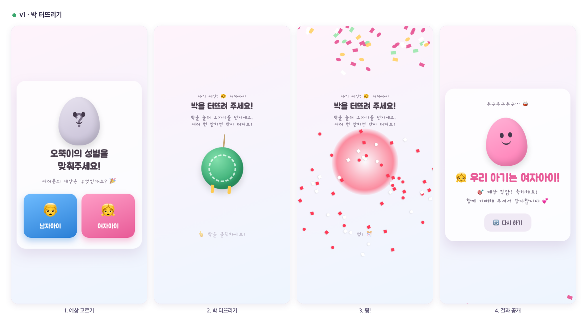
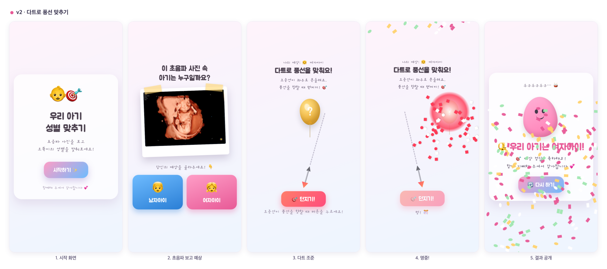
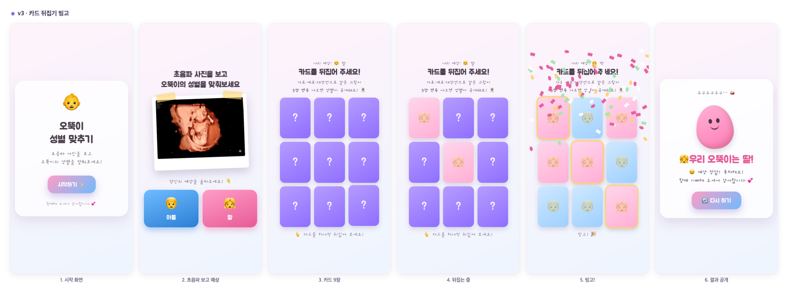

# 🍼 젠더리빌 (Gender Reveal)

아기 성별을 가족·친구들과 함께 공개하는 웹 미니게임입니다.
링크만 열면 바로 시작되고, 설치도 회원가입도 없습니다.

라이브러리·빌드 도구 없이 **순수 HTML + CSS + JavaScript**로만 만들었습니다.

## 공통 흐름

세 버전 모두 진행 방식은 같습니다.

1. 참여자가 **자기 예상(아들/딸)** 을 고른다
2. 버전별 **미니게임**을 하나 클리어한다
3. 클리어하는 순간 **실제 성별이 공개**되고 색종이가 쏟아진다

---

## v1 · 박 터뜨리기 🎊



박을 누를 때마다 오자미가 날아가 박을 때리고, **10번** 맞히면 박이 터집니다.
터지는 순간 박 안에서 성별 색이 사방으로 퍼집니다.

- 실력이 필요 없어 누구나 클리어 가능
- 대신 긴장감이 짧은 편

**진입점** — [`index.html`](index.html)

---

## v2 · 다트로 풍선 맞추기 🎯



조준선이 좌우로 흔들리고 풍선도 떠다닙니다. 타이밍을 맞춰 던져야 명중합니다.
명중 판정은 충돌 검사가 아니라 **회전축에서 풍선을 향하는 각도**와 발사 각도를 비교하는 방식이고,
풍선까지의 거리에 따라 허용 오차를 계산합니다(가까울수록 관대).

이 버전부터 **초음파 사진을 보고 예상하는 단계**가 들어갔습니다.

- 난이도 조절은 [`v2/script.js`](v2/script.js) 상단 상수로
  - `MAX_AIM_ANGLE` — 조준선이 흔들리는 최대 각도
  - `AIM_SPEED` — 조준선 회전 속도
  - `BALLOON_SPEED` — 풍선이 떠다니는 속도
- 조작이 꽤 어려워서 연령대가 다양한 자리에는 비추천

**진입점** — [`v2/index.html`](v2/index.html)

---

## v3 · 카드 뒤집기 빙고 🃏 (권장)



3×3 카드 9장을 하나씩 뒤집다가 **가로·세로·대각선으로 같은 그림이 3장 연속**되면
빙고와 함께 성별이 공개됩니다. 실제 이벤트는 이 버전으로 진행했습니다.

- 조작 실력이 전혀 필요 없어 누구나 참여 가능
- 여러 명이 한 장씩 번갈아 뒤집을 수 있음
- 카드가 열릴수록 색 비율이 드러나 긴장감이 길게 이어짐
- 빙고 완성 후 **5초 뒤** 결과 화면으로 전환 (여운을 주는 텀)

**진입점** — [`v3/index.html`](v3/index.html)

### 빙고가 반대 성별로 나지 않는 이유

카드를 무작위로 섞으면 정답과 반대되는 색으로 빙고가 먼저 완성될 수 있습니다.
[`v3/script.js`](v3/script.js)의 `generateBoard()`는 rejection sampling으로 아래 조건을 모두 만족하는 배치만 채택합니다.

- 정답 성별 **5칸**, 반대 성별 **4칸**
- 완성된 빙고 라인이 **정확히 1개**
- 그 라인이 **반드시 정답 성별**

덕분에 어떤 순서로 뒤집어도 빙고는 정답 성별로만 완성됩니다.
무한 루프 방지를 위해 시도 횟수는 500회로 제한되어 있습니다.

### 예상 투표 집계 (선택)

v3는 참여자가 아들/딸 버튼을 누를 때 `/log.gif?choice=boy|girl` 을 `navigator.sendBeacon`으로 호출합니다.
화면에는 아무것도 표시되지 않고, 웹서버 액세스 로그에만 기록이 남습니다.

이 로그를 `시간 \t 쿼리스트링 \t IP` 형태의 TSV로 가공해 `/guess-log.tsv` 로 서빙하면,
[`v3/stats.html`](v3/stats.html)에서 집계를 볼 수 있습니다.

- IP당 마지막 투표만 유효표로 집계
- 아들/딸 비율 막대그래프 + 최근 투표 목록
- 20초마다 자동 갱신

로그 수집을 쓰지 않을 경우 `logGuess()` 호출만 지우면 됩니다. 게임 동작에는 영향이 없습니다.

---

## 시작하기

### 1. 아기 성별 설정

사용할 버전의 `script.js` 맨 윗줄 한 줄만 바꾸면 됩니다.

```js
const ACTUAL_GENDER = 'girl'; // 'boy' 또는 'girl'
```

게임 색상, 카드 배치, 축하 문구, 색종이 색까지 전부 이 값을 따라갑니다.

### 2. 초음파 사진 교체 (v2 · v3)

`v2/ultrasound.jpeg` / `v3/ultrasound.jpeg` 를 본인 사진으로 덮어씁니다. 파일명은 그대로 유지하세요.

### 3. 실행

`index.html` 을 브라우저로 열면 바로 실행됩니다. 빌드도 의존성 설치도 필요 없습니다.

폰으로 함께 보려면 같은 네트워크에서 정적 서버를 띄우거나, 정적 호스팅에 올려 링크를 공유하면 됩니다.

```bash
python3 -m http.server 8000
# 폰에서 http://<PC의 IP>:8000/v3/ 접속
```

---

## 프로젝트 구조

```
.
├── index.html        # v1 · 박 터뜨리기
├── script.js
├── style.css
├── v2/               # v2 · 다트로 풍선 맞추기
│   ├── index.html
│   ├── script.js
│   ├── style.css
│   └── ultrasound.jpeg
├── v3/               # v3 · 카드 뒤집기 빙고 (권장)
│   ├── index.html
│   ├── script.js
│   ├── style.css
│   ├── stats.html    # 예상 투표 집계 화면
│   └── ultrasound.jpeg
└── readme/           # README용 화면 이미지
```

## 기술 스택

| 항목 | 내용 |
|---|---|
| 언어 | HTML, CSS, JavaScript (Vanilla) |
| 빌드 | 없음 |
| 의존성 | 없음 (Google Fonts `Gaegu`, `Jua` 만 사용) |
| 화면 | 모바일 세로 기준 반응형 |
